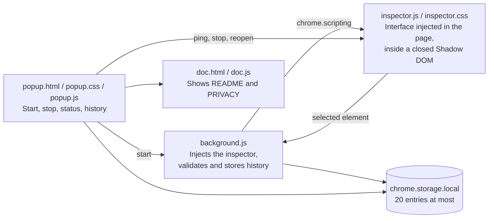

# Trace

Inspect the web, one element at a time.

Trace is a small Chrome extension for looking at how a page is built without opening DevTools. Start it, hover the page, click an element, and read its tag, classes, size, computed styles and colors in a compact panel.

Built with plain HTML, CSS and JavaScript on Manifest V3. No framework, no build step, no server, no tracking.

## Features

- **Pick any element**: a highlight and a label follow the pointer. Click to select.
- **Element details**: tag, ID, classes, a generated CSS selector, parent and hierarchy.
- **Box model**: size, viewport position, padding, borders and margins.
- **Computed styles**: twelve useful properties, clearly labelled as final values and not as the original CSS rules.
- **Colors**: text, background, border and a few colors used inside the element, with HEX values.
- **Copy**: selector, classes, tag, a style summary or the full data as JSON.
- **History**: the last 20 inspections, stored on your device only.
- **Safe while picking**: clicks never reach the page, so no link or button is triggered.
- **Private by design**: nothing is sent anywhere. See the [privacy policy](PRIVACY.md).

## Install for development

1. Open `chrome://extensions` in Chrome.
2. Turn on **Developer mode** (top right).
3. Click **Load unpacked** and choose this folder.
4. Pin Trace from the extensions menu to keep its icon visible.

## How to use it

1. Open a regular website.
2. Click the Trace icon, then **Start Inspecting**. You can also press `Alt+Shift+X`.
3. Hover the page and click an element.
4. Read the panel. Click an ancestor in **Hierarchy** to move up, or **Inspect again** to pick something else.
5. Press `Esc` or the cross to close Trace.

Trace cannot run on Chrome's own pages (`chrome://`), on the Chrome Web Store, or on local files unless you allow file access for the extension. The popup explains why when that happens.

## Permissions

| Permission  | Why                                                          |
| ----------- | ------------------------------------------------------------ |
| `activeTab` | Access to the current tab, only after you start Trace on it. |
| `scripting` | Adds the inspection interface to that tab.                   |
| `storage`   | Keeps the local history of the last 20 inspections.          |

There are no host permissions and no content script that runs automatically.

## Project structure

| File                            | Role                                                    |
| ------------------------------- | ------------------------------------------------------- |
| `manifest.json`                 | Manifest V3 declaration                                 |
| `background.js`                 | Service worker: injection, history validation, shortcut |
| `popup.*`                       | The extension popup                                     |
| `inspector.js`, `inspector.css` | The inspector injected in the active tab                |
| `doc.html`, `doc.js`            | Small viewer for the two Markdown documents             |
| `icons/`                        | PNG icons and their SVG source                          |
| `STORE.md`                      | Texts and checklist for the Chrome Web Store listing    |

## How it works

- **On demand.** The popup asks the service worker to inject `inspector.js` into the active tab with `chrome.scripting`. Nothing is injected before that.
- **Isolated interface.** Everything Trace draws lives in one host element with a closed Shadow DOM. The page's styles cannot reach it, and its styles cannot leak out.
- **Picking overlay.** While you pick, a transparent layer covers the page and receives the pointer. Trace looks up the element underneath, so the page never gets the click.
- **Clean exit.** Closing Trace removes its element, its three window listeners and its timer. Starting it again reuses the same instance.
- **Minimal history.** The service worker rebuilds each history entry from known fields only, with type and length checks, and keeps the page origin instead of the full address.

## Testing

Automated checks were run with the real `inspector.js`, `popup.js` and `background.js`, with the extension APIs replaced by mocks in headless Chrome and Node:

- selection, selector generation, box model, computed styles and colors on a fixture page;
- elements with several classes and no ID, transparent backgrounds, SVG elements, modern color spaces, deep nesting;
- password fields refused, no page text or form value in the collected data;
- Escape, repeated activation and stop, no duplicate interface, no leaked listener;
- copy actions and the copy failure message;
- popup states: ready, inspecting, blocked page, no tab, empty history, full history, hostile stored values;
- history validation, the 20 entry limit and message sender checks.

Still to be checked by hand in a real Chrome profile, because the extension could not be loaded by the automated browser:

- loading the unpacked extension and starting it from the popup and the shortcut;
- a real single-page application and a page with a strict Content Security Policy;
- navigation while Trace is active;
- protected pages (`chrome://extensions`, the Chrome Web Store, a PDF);
- the clipboard fallback on a plain `http://` page.

## Packaging

Zip the content of this folder (with `manifest.json` at the root of the archive) and upload it in the Chrome Web Store developer dashboard. `README.md`, `PRIVACY.md` and `LICENSE` must stay in the archive: the popup links to the first two. `STORE.md` can be left out.

## License

[MIT](LICENSE) © 2026 Kone Issa
